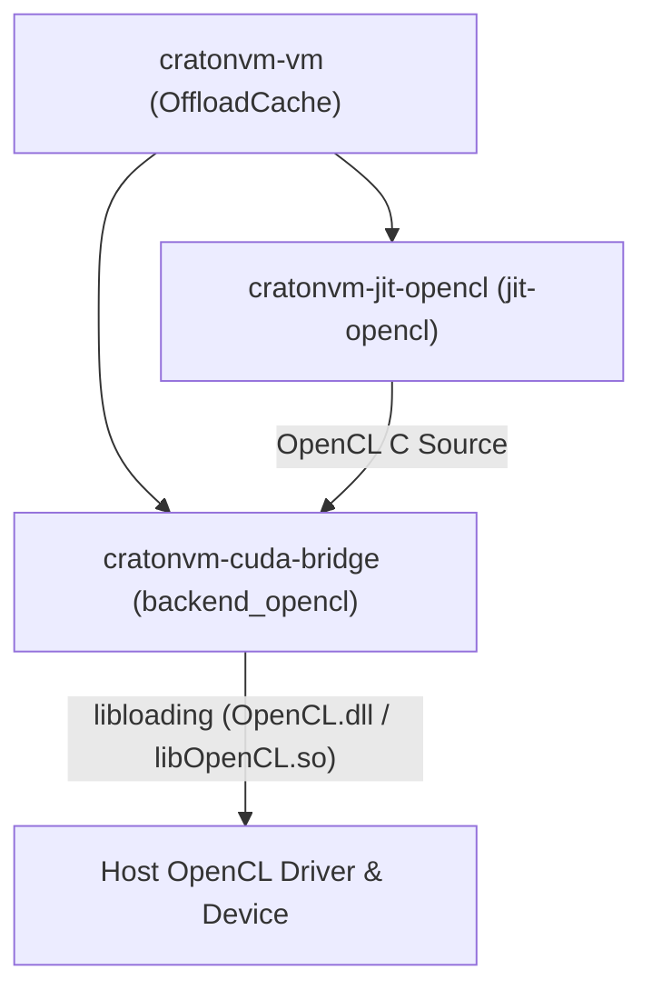

# The OpenCL Backend: Architecture, Runtime Loading, and Verification

**OpenCL Backend.** Portable accelerator offload supporting NVIDIA, AMD, Intel, and Apple platforms.

This document describes the design, implementation, and verification of the OpenCL backend for CratonVM.

---

## 1. Design & Core Principles

Unlike CUDA (NVIDIA-only) and HIP (AMD/ROCm-only), OpenCL is an open, multi-vendor industry standard.
Implementing OpenCL enables CratonVM to offload compute kernels across diverse accelerator hardware:
- NVIDIA GPUs
- AMD GPUs & APUs
- Intel Integrated & Discrete GPUs (Iris Xe, Arc)
- Apple Silicon (via Apple OpenCL compatibility layer)

### Zero Build-Time Dependencies

Following CratonVM's strict packaging and CI requirements:
- **No SDK required at build time**: Neither OpenCL headers nor vendor SDKs are needed to build.
- **Dynamic runtime loading**: Uses `libloading` to load `OpenCL.dll` (Windows), `libOpenCL.so.1` / `libOpenCL.so` (Linux), or `OpenCL.framework` (macOS) at runtime.
- **Fail-safe fallback**: If the OpenCL runtime library is absent, `BackendApi::probe_device()` returns `DeviceError::NoDriver` cleanly without panicking, allowing the VM to fall back to CPU execution.

---

## 2. Component Architecture

The OpenCL backend consists of three main tiers:

### Tier 1: OpenCL Lowering Target (`cratonvm-jit-opencl`)
Located in `jit-opencl/`:
- Translates target-neutral Kernel IR (`kir`) and `PtxModule` into standard OpenCL C source code.
- Features:
  - Generates OpenCL C 1.2 / 2.0+ compatible code.
  - Automatically emits `#pragma OPENCL EXTENSION cl_khr_fp64 : enable` when 64-bit floating point is required.
  - Emits `#pragma OPENCL EXTENSION cl_khr_int64_base_atomics : enable` and `cl_khr_int64_extended_atomics` for 64-bit integer atomics.
  - Translates register declarations and arithmetic instructions into standards-compliant OpenCL C.
  - Handles conversions (`craton_f2i`, `craton_d2l`, `craton_f2l`) matching HotSpot 25 / IEEE-754 semantics.
  - Correctly maps memory addressing to `__global` pointers and handles thread indexing (`get_global_id(0)`).

### Tier 2: Driver Backend (`cratonvm-cuda-bridge`)
Located in `cuda-bridge/src/backend_opencl.rs`, gated behind Cargo feature `opencl`:
- Implements:
  - `BackendApi`: Probing platforms and devices, extracting `OpenClCaps` (version, compute units, workgroup sizes, extensions, warp/subgroup size).
  - `DeviceContextApi`: Context lifecycle, command queue management (`copy_h2d`, `copy_d2h`), and thread-binding via `CURRENT_DEVICE`.
  - `DeviceModuleApi`: JIT compilation of OpenCL C source via `clCreateProgramWithSource` and `clBuildProgram`, kernel handle caching, and argument marshalling (`clSetKernelArg`).
  - `DriverApi`: Stream and event orchestration. To resolve OpenCL's requirement that events in `clEnqueueBarrierWithWaitList` share the same context as the command queue, `RawEvent` is managed via `OpenClEventHandle { cl_event: Mutex<cl_event>, context: cl_context }`, recycled through `EventPool`.

### Tier 3: VM Runtime & CLI Integration
- `vm/Cargo.toml`: Exposes `gpu-target-opencl` feature, depending on `cratonvm-jit-opencl`.
- `vm/src/runtime/offload.rs`:
  - `OffloadTarget::OpenCl(jit_opencl::OpenClTarget)` variant.
  - Probes `DeviceArch::OpenCl` and configures target lowering parameters.
  - Automatically renders OpenCL C from lowered bytecode and loads into the device module.
- `vm-cli/Cargo.toml`: Exposes `gpu-driver-opencl` feature (`["gpu", "cuda-bridge/opencl", "cratonvm-vm/gpu-target-opencl"]`).
- `vm-cli/src/main.rs`: Reports OpenCL device architectures in `--gpu-info`.

---

## 3. Verification & Test Matrix

| Verification Step | Command | Status |
|---|---|---|
| OpenCL C rendering tests | `cargo test -p cratonvm-jit-opencl` | Passed |
| OpenCL driver integration & vector add | `cargo test -p cratonvm-cuda-bridge --features opencl --test opencl_module_it` | Passed (Hardware: RTX 2060, OpenCL 3.0) |
| Bridge compilation (stub mode) | `cargo check -p cratonvm-cuda-bridge` | Passed |
| VM compilation with OpenCL | `cargo check -p cratonvm-vm --features gpu-offload,gpu-target-opencl` | Verified |
| CLI launcher with OpenCL driver | `cargo check -p cratonvm-cli --features gpu-driver-opencl` | Verified |

## Shared-Memory APUs & Wavefront Width

On OpenCL devices, `backend_opencl` probes `CL_DEVICE_HOST_UNIFIED_MEMORY`, `CL_DEVICE_SVM_CAPABILITIES`, and AMD `CL_DEVICE_WAVEFRONT_WIDTH_AMD` / `CL_DEVICE_GFXIP_MAJOR_AMD` so RDNA and Ryzen AI APUs report wavefront width 32 cleanly and alias host buffers zero-copy via `CL_MEM_USE_HOST_PTR` (with synchronous map/unmap coherency sync on readback). Built-in GEMM and fp16 kernels (`vm/src/runtime/kernels/gemm.cl`) compile directly via the OpenCL C runtime.
